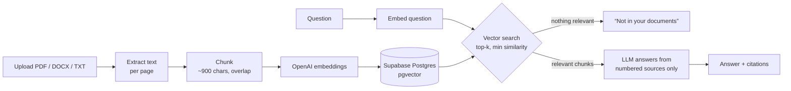

# DocuMind

Upload PDFs, Word files or notes, then ask questions in plain English. DocuMind answers **only from your documents** and links every sentence back to the passage and page it came from. If the answer isn't in your files, it says so instead of guessing.


## Features

- **Grounded answers with citations.** Each answer cites numbered sources; click one to see the exact passage and page.
- **Honest "I don't know".** If no passage is relevant enough, DocuMind replies that it couldn't find it, without calling the model at all.
- **Scoped search.** Tick specific documents to search only those.
- **Document automations** with validated JSON outputs:
  - Resume ↔ job description match: score, matched and missing skills, suggested edits
  - Meeting summary: decisions, action items with owners and dates, open questions
  - Briefing report: executive summary, key points, risks, recommendations
- **Edge cases handled:** unsupported formats, empty files, scanned PDFs with no text layer, oversize uploads and malformed model replies (retried once against the schema).

## How it works



## Stack

| Layer | Tech |
|---|---|
| Frontend | Next.js 15, React 19, TypeScript |
| API | Python, FastAPI, Pydantic |
| Retrieval | OpenAI `text-embedding-3-small`, Supabase Postgres with pgvector (HNSW, cosine) |
| Generation | OpenAI `gpt-4o-mini` with JSON output |
| Parsing | pypdf, python-docx |
| Tests | pytest with a deterministic fake embedder and scripted model |

## Run it locally

### 1. Database (optional)

Without a database, DocuMind keeps everything in memory, which is fine for trying it out. For persistence, create a Supabase project, open the SQL editor and run [`supabase/schema.sql`](supabase/schema.sql).

### 2. API

```bash
cd backend
python -m venv .venv && source .venv/bin/activate   # Windows: .venv\Scripts\activate
pip install -r requirements.txt
cp .env.example .env        # add OPENAI_API_KEY, and DATABASE_URL if using Supabase
uvicorn app.main:create_app --factory --reload
```

Interactive API docs: http://localhost:8000/docs

### 3. Web app

```bash
cd frontend
npm install
cp .env.example .env.local
npm run dev
```

Open http://localhost:3000.

### Tests

```bash
cd backend
pip install -r requirements-dev.txt
pytest
```

The tests run without an API key or database.

## API

| Method | Path | What it does |
|---|---|---|
| `POST` | `/documents` | Upload a file (multipart). Returns id, pages and chunk count. |
| `GET` | `/documents` | List uploaded documents |
| `DELETE` | `/documents/{id}` | Delete a document and its chunks |
| `POST` | `/query` | `{question, document_ids?}` → answer, `grounded`, citations |
| `POST` | `/tools/resume-match` | `{resume_document_id \| resume_text, job_description}` |
| `POST` | `/tools/meeting-summary` | `{document_id \| text}` |
| `POST` | `/tools/report` | `{document_id \| text}` |

## Project layout

```
backend/
  app/extract.py      PDF / DOCX / TXT → text per page
  app/chunking.py     overlapping chunks that keep their page number
  app/store.py        pgvector store + in-memory store behind one interface
  app/rag.py          retrieval, relevance cut-off, cited answers
  app/automation.py   resume match, meeting summary, report (Pydantic schemas)
  app/main.py         FastAPI routes
  tests/              API and chunking tests
frontend/
  app/page.tsx        layout and tabs
  components/         document panel, ask panel, automations
supabase/schema.sql   tables and vector index
```

## Design notes

- **Relevance cut-off before generation.** Search results under `MIN_SIMILARITY` are dropped. If none are left, the API answers "not found" directly, which removes the most common source of made-up answers and saves tokens.
- **Citations are checked, not trusted.** Source numbers are taken from both the model's `sources_used` field and the `[n]` markers in the text, and anything out of range is discarded.
- **Pluggable model and store.** `Embedder`, `ChatModel` and `VectorStore` are small interfaces, which is what lets the tests run offline.

## License

MIT
